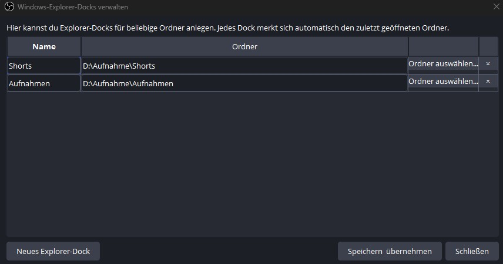
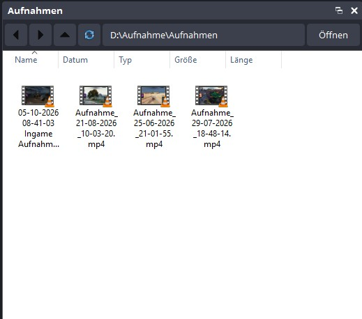

# Explorer Dock

[](https://github.com/xlTheCrow/explorer-dock/releases/latest)
[](https://github.com/xlTheCrow/explorer-dock/actions/workflows/build-windows.yml)
[](https://github.com/xlTheCrow/explorer-dock/releases)
[](LICENSE)


**Explorer Dock** is a free, open-source **OBS Studio plugin for Windows** that embeds a native **Windows Explorer / file browser dock directly inside OBS Studio**.

It is designed for streamers, video editors and creators who want faster access to **recordings, clips, thumbnails, project files and media folders** without constantly switching away from OBS. Explorer Dock works with **Windows 10 and Windows 11** and provides separate Windows x64 builds for **OBS Studio 32.x and 33.x**.

> Current release: **v0.2.4** · Separate packages for **OBS Studio 32.x and OBS Studio 33.0.x**

## Download

➡️ **[Download Explorer Dock v0.2.4](https://github.com/xlTheCrow/explorer-dock/releases/latest)**

Choose the ZIP that matches your OBS Studio major version:

| OBS Studio version | Download |
| --- | --- |
| **OBS 32.x** | `Explorer-Dock-v0.2.4-OBS32-Windows-x64.zip` |
| **OBS 33.0.x** | `Explorer-Dock-v0.2.4-OBS33-Windows-x64.zip` |

**Important:** Do not install both packages at the same time. Choose only the package matching your OBS Studio version.

## OBS Studio Windows Explorer Dock – Features

- Native Windows Explorer view directly inside OBS Studio
- Multiple independent Explorer docks
- Back, forward, parent-folder and refresh navigation
- Editable path bar with `Open / Öffnen`
- Native Windows file icons and thumbnails
- Native Windows context menus
- Windows Shell drag-and-drop support
- Remembers the last folder used by each dock
- German and English interface strings
- Separate, versioned ready-to-install packages for OBS 32 and OBS 33

## Screenshots

### Dock management



Create and manage multiple Explorer docks, choose their names and assign a start folder.

### Explorer Dock in OBS



The dock provides native Windows Explorer thumbnails, navigation controls and direct access to your files inside OBS.

## Requirements and compatibility

- Windows 10 or Windows 11
- 64-bit Windows
- OBS Studio 32.x or OBS Studio 33.0.x, 64-bit

The packages are built separately against OBS 32.0.2 and OBS 33.0.1 respectively. Later OBS point releases may work, but are not independently guaranteed. A successful CI build confirms compilation; runtime compatibility should still be checked in OBS itself.

## Install Explorer Dock for OBS Studio

1. Close OBS Studio completely.
2. Open the [latest release](https://github.com/xlTheCrow/explorer-dock/releases/latest).
3. Download **only** the ZIP for your OBS version.
4. Extract the package using the matching instructions below.
5. Start OBS Studio.
6. Open **Tools → Windows Explorer Docks...**
7. Create a dock, choose a folder and select **Save & Apply / Speichern & übernehmen**.

### OBS Studio 32.x – Legacy plugin folder structure

Extract the **contents** of the OBS32 ZIP directly into your OBS Studio installation directory. Allow the included `obs-plugins` and `data` folders to merge with the existing OBS folders.

```text
obs-plugins\
└── 64bit\
    ├── obs-explorer-dock.dll
    └── obs-explorer-dock.pdb

data\
└── obs-plugins\
    └── obs-explorer-dock\
        ├── manifest.json
        └── locale\
            ├── de-DE.ini
            └── en-US.ini
```

### OBS Studio 33.x – New plugin folder structure

The OBS33 ZIP contains an `obs-explorer-dock` folder. Copy that **entire folder** into:

`%ProgramData%\obs-studio\plugins`

The resulting installation should look like this:

```text
%ProgramData%\obs-studio\plugins\
└── obs-explorer-dock\
    ├── obs-explorer-dock.dll
    ├── obs-explorer-dock.pdb
    └── data\
        ├── manifest.json
        └── locale\
            ├── de-DE.ini
            └── en-US.ini
```

### Portable OBS installation (Windows)

A portable OBS installation keeps its plugins inside the extracted OBS folder. The portable folder is the directory that contains `bin`, `data` and the plugin folders.

To enable Portable Mode, create an empty file named `portable_mode.txt` in this folder. Alternatively, start `bin\64bit\obs64.exe` with the `--portable` launch parameter. See the official [OBS Portable Mode guide](https://obsproject.com/kb/portable-mode).

1. Close OBS Studio completely.
2. Open your portable OBS folder (the folder containing `bin` and `data`; plugin folders may not exist yet).
3. Copy the files from the matching Explorer Dock package as described below.
4. Start OBS again in Portable Mode.

#### Portable OBS 32.x

Extract the **contents** of the OBS32 ZIP into the root of your portable OBS folder. Allow the `obs-plugins` and `data` folders to merge with the existing folders.

The resulting paths should look like this:

```text
<OBS-Portable>\
├── obs-plugins\
│   └── 64bit\
│       ├── obs-explorer-dock.dll
│       └── obs-explorer-dock.pdb
└── data\
    └── obs-plugins\
        └── obs-explorer-dock\
            ├── manifest.json
            └── locale\
                ├── de-DE.ini
                └── en-US.ini
```

#### Portable OBS 33.x

Copy the complete `obs-explorer-dock` folder from the OBS33 ZIP into the `plugins` folder inside your portable OBS root. Create the `plugins` folder if it does not already exist.

The resulting paths should look like this:

```text
<OBS-Portable>\
└── plugins\
    └── obs-explorer-dock\
        ├── obs-explorer-dock.dll
        ├── obs-explorer-dock.pdb
        └── data\
            ├── manifest.json
            └── locale\
                ├── de-DE.ini
                └── en-US.ini
```

**Important for OBS 33:** For portable launches, OBS 33 loads plugins from the `plugins` folder inside the portable OBS root. It ignores the normal `%ProgramData%\obs-studio\plugins` location. Do not use the legacy `obs-plugins\64bit` location for the OBS33 package. See the official [OBS plugin location and developer guide](https://obsproject.com/kb/legacy-plugin-developer-info).

## Using the file browser dock in OBS Studio

Each dock behaves like a lightweight Windows Explorer embedded into OBS.

You can:

- navigate between folders
- double-click files and folders
- use native Windows context menus
- view Windows thumbnails
- drag files to other applications where supported
- enter a path manually in the address field
- press **Enter** or click **Open / Öffnen** to navigate to that path

Each Explorer Dock remembers the last folder you opened.

## Known limitations

- Windows only.
- The actual file view is provided by Windows through `IExplorerBrowser`.
- Because of that, the large Explorer area follows Windows styling instead of the active OBS theme.
- Explorer Dock creates its own Explorer browser view; it does not embed an already-open File Explorer window or tab.
- Small visual or behavioral differences can occur between Windows versions because the Shell UI is provided by the operating system.

## Troubleshooting

### Explorer Dock does not appear under Tools

Check that you downloaded the package for the correct OBS version and that the files are in the matching location:

- **OBS 32.x:** `obs-plugins\64bit\obs-explorer-dock.dll` inside your OBS installation directory.
- **OBS 33.x:** `%ProgramData%\obs-studio\plugins\obs-explorer-dock\obs-explorer-dock.dll`.

Then restart OBS completely. If the plugin still does not appear, open **Help → Log Files → View Current Log** and include the relevant lines in a bug report.

### The dock opens, but something behaves incorrectly

Open an issue and include your OBS log together with the steps required to reproduce the problem.

## Reporting bugs

Please use the [Bug Report template](https://github.com/xlTheCrow/explorer-dock/issues/new/choose) and include:

- Explorer Dock version
- OBS Studio version
- Windows version
- relevant OBS log lines
- exact reproduction steps
- screenshots when useful

## Feature requests

Ideas and improvements are welcome through the [GitHub issue tracker](https://github.com/xlTheCrow/explorer-dock/issues/new/choose).

## Building from source

Explorer Dock uses the official OBS plugin template build system and GitHub Actions for Windows builds.

The repository contains:

- C++ / Qt source
- separate OBS 32 and OBS 33 build specifications
- Windows build scripts
- automated Windows CI for both targets
- a release workflow that creates two versioned Windows packages

Run the build script in PowerShell:

```powershell
./build-windows.ps1 -ObsTarget OBS32
./build-windows.ps1 -ObsTarget OBS33
```

The resulting DLLs are placed in `dist/OBS32` and `dist/OBS33`.

## AI-assisted development disclosure

Development of Explorer Dock was substantially assisted by OpenAI ChatGPT.

AI assistance was used for C++ implementation, build-system setup, debugging, packaging and documentation. Builds are validated through GitHub Actions. Runtime compatibility must be verified in the respective OBS versions.

## License

Explorer Dock is free software licensed under the **GNU General Public License version 2**.

See [LICENSE](LICENSE) for the full license text.

## Disclaimer

Explorer Dock is an independent community project and is **not affiliated with or endorsed by the OBS Project**.

## Keywords

OBS Studio plugin, Windows Explorer dock, OBS file browser, OBS dock plugin, OBS 33 plugin, OBS 32 plugin, Windows 11 OBS plugin, Windows 10 OBS plugin, creator workflow, recordings browser, clips browser, media file management.
